<h1>LAPORAN HASIL PRAKTIKUM 9 | PHP<h1>

<h4>Nama        :Eka Sari Praditya
    NIM         :312510021
    Mata Kuliah :Pemrograman Web<h4>

# Latihan 1
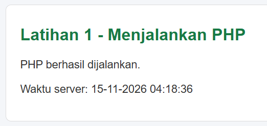
# Latihan 2
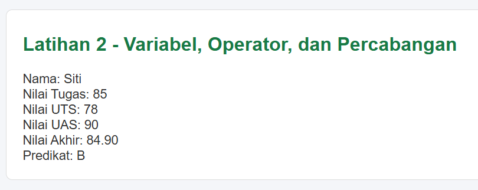
# Latihan 3
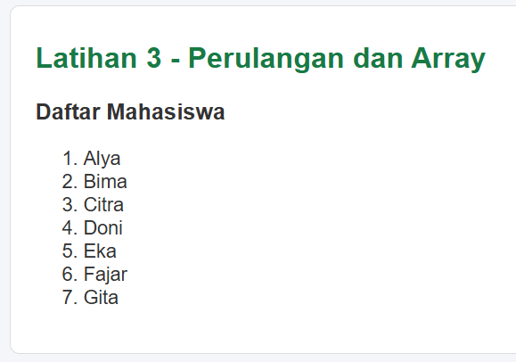
# Latihan 4
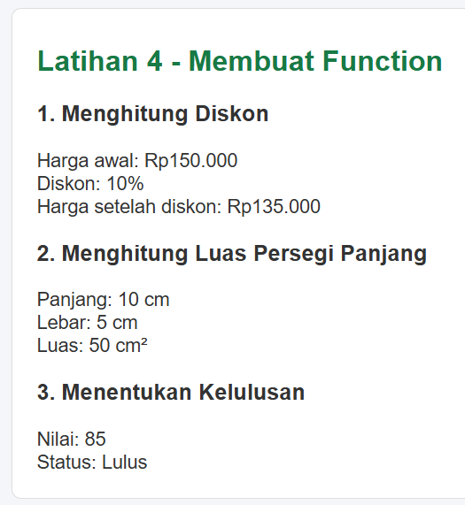
# Latihan 5
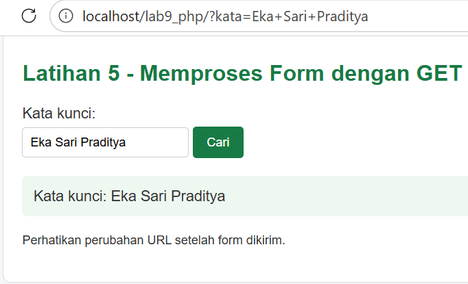
# Latihan 6
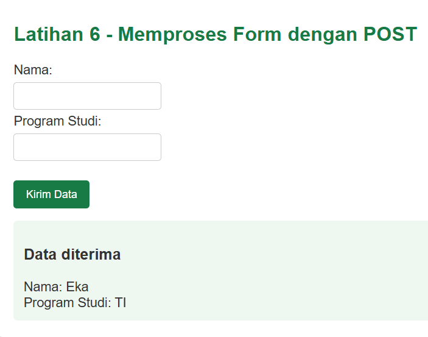
# Latihan 7
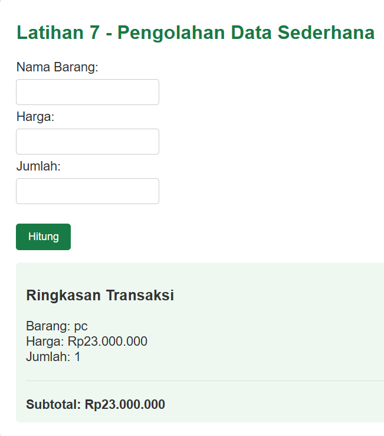
# Eksperimen G1
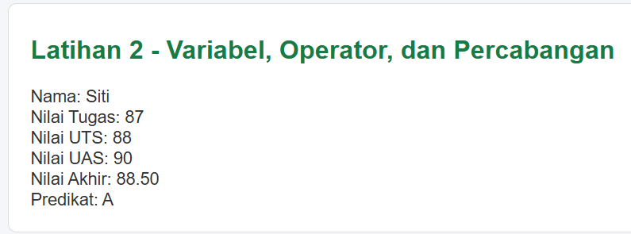
# Eksperimen G2
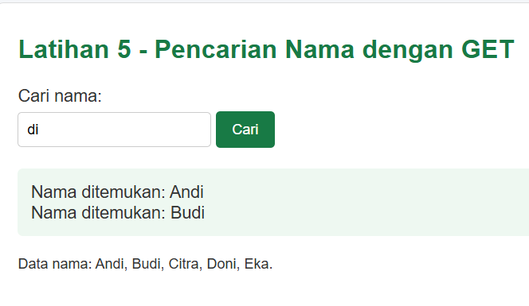
# Eksperimen G3
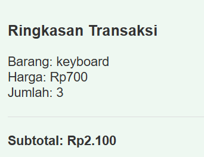
# Eksperimen G4
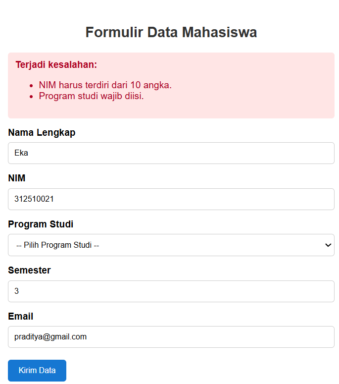
# Eksperimen G5
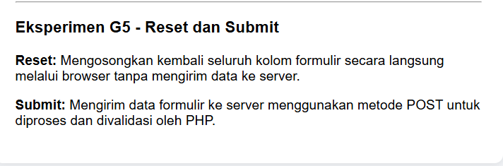

## H. Pertanyaan Evaluasi

**1. Apa perbedaan pemrosesan client-side dan server-side?**

Client-side adalah proses pengolahan data yang dilakukan di sisi pengguna melalui browser. Contohnya menggunakan HTML, CSS, dan JavaScript. Sedangkan server-side adalah proses pengolahan data yang dilakukan di server menggunakan bahasa pemrograman seperti PHP. Hasil pemrosesan server kemudian dikirimkan kembali ke browser pengguna.

**2. Mengapa file PHP harus dijalankan melalui web server?**

Karena PHP merupakan bahasa pemrograman yang diproses di sisi server. Web server seperti Apache diperlukan untuk menjalankan kode PHP dan mengirimkan hasilnya ke browser dalam bentuk HTML. Jika file PHP dibuka langsung tanpa server, kode PHP tidak akan diproses sebagaimana mestinya.

**3. Apa fungsi tanda $ pada variabel PHP?**

Tanda `$` digunakan untuk menandai variabel dalam PHP. Setiap variabel PHP harus diawali dengan tanda tersebut, misalnya `$nama`, `$umur`, dan `$nilai`. Variabel berfungsi untuk menyimpan data yang dapat digunakan dan diolah kembali dalam program.

**4. Apa perbedaan metode GET dan POST?**

GET adalah metode pengiriman data melalui URL sehingga data yang dikirim dapat terlihat pada alamat browser. Metode ini biasanya digunakan untuk pencarian atau mengambil data. Sedangkan POST mengirimkan data melalui bagian body request sehingga data tidak ditampilkan langsung pada URL. POST biasanya digunakan untuk mengirim formulir atau data yang akan diproses di server.

**5. Mengapa input pengguna perlu divalidasi di sisi server?**

Karena data yang dimasukkan pengguna belum tentu sesuai dengan ketentuan yang ditetapkan. Validasi di sisi server diperlukan untuk memastikan data benar, lengkap, dan sesuai format sebelum diproses. Validasi server juga penting karena pemeriksaan di sisi browser dapat dilewati atau dimanipulasi oleh pengguna.

**6. Apa fungsi htmlspecialchars() ketika menampilkan data dari form?**

`htmlspecialchars()` berfungsi untuk mengubah karakter khusus HTML menjadi bentuk yang aman ketika ditampilkan pada halaman web. Contohnya karakter `<` dan `>` akan diubah menjadi entitas HTML. Fungsi ini membantu mencegah serangan XSS (Cross-Site Scripting) ketika menampilkan data yang berasal dari input pengguna.

**7. Apa manfaat penggunaan function dalam program PHP?**

Function bermanfaat untuk mengelompokkan kode program berdasarkan tugas tertentu agar lebih terstruktur dan mudah digunakan kembali. Dengan function, kita tidak perlu menulis kode yang sama berulang kali. Selain itu, function membuat program lebih mudah dibaca, diperbaiki, dan dikembangkan.